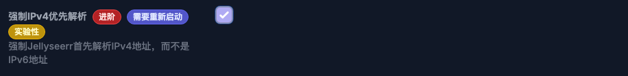
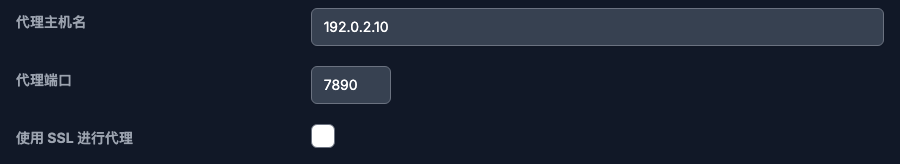
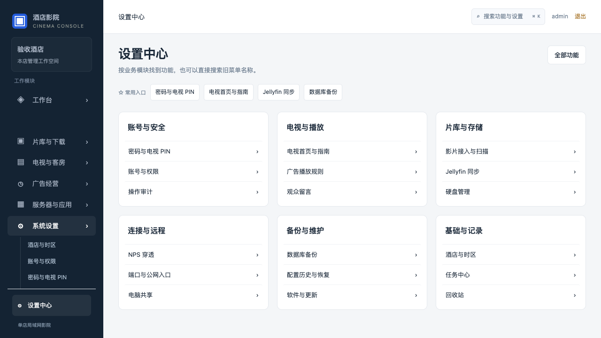
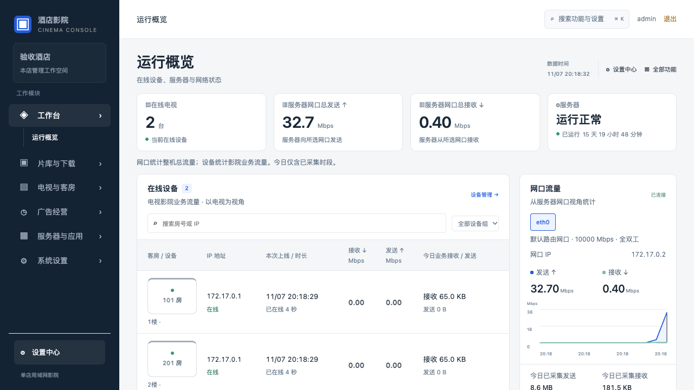

# 全新 Ubuntu 安装教程

文档版本 IN20-DOC09，更新于 2026-11-10。当前唯一交付目录为 01_最新版交付；01 为已有影院升级，02 为全新 Ubuntu 安装，03 为电视施工，04 为使用教程。保留 SSH、国内/海外、本地完整包、TMDB 与存储切换。旧 IN20 的 R740 现场结果和本轮隔离验证分别记录。

## 01 开工前的准备与安装方式

### 版本与本次实测

Ubuntu 24.04 LTS amd64，后台 v1-0-0-rc5-in20，电视 0.1.17 / code18，施工工具 2.0.5。新首装已整合 RQ02/RQ04、IN20 和 TI21 修复，无需安装后再补这些版本。IN20 未在酒店现场部署，验证范围见第 19 页。

### 先选安装方式

| 方式 | 需要准备与访问的内容 |
|---|---|
| 中国大陆在线一键 | 第 6 页 IN20 命令，GitHub API 及其附件下载域名、可用 Ubuntu APT 源、清华 Docker APT 源 |
| 海外在线一键 | 第 8 页完整命令，Docker 官方 APT 源，再进入同一 IN20 入口 |
| 本地完整包 | 第 9-10 页，U 盘携带镜像与附件，Ubuntu 与 Docker 系统软件包仍通过 APT 安装 |

本地包安装时，现场按所选地区准备可访问的 APT 源。默认安装使用“酒店影院”、本机路由识别的 IP、Ubuntu 主机时区、`/srv/hotel-tv/media/.automation`，完成后在后台设置本店资料。

### 施工材料

1. 专用服务器、显示器、键盘鼠标、有线网络。标记系统盘和影片盘的型号、容量及序列号。
2. 16GB 以上启动 U 盘。携带本地完整包时另备资料 U 盘，单文件需容纳约 1.2GB，包总量约 4.4GiB。
3. 本店管理员、路由器管理条件、测试影片、合法可用的下载及字幕来源账号。

### 阅读顺序

装 Ubuntu 见第 2 页，先开 SSH 见第 3 页，网络与影片盘见第 4-5 页，安装见第 6-10 页。首次登录与片库配置见第 11-12 页，TMDB 提示及设置见第 13-15 页，首台电视与验收见第 16-17 页。

安装故障见第 18 页，实测记录见第 19 页，手动切换存储与回退见第 20-28 页。已有 Ubuntu 从第 3 页开始。已有影院统一DEB直升见第 31 页，A 版菜单与首页见第 29-30 页，日常操作见第 32-34 页。

## 02 安装 Ubuntu 操作系统

### 1. 下载 ISO，制作启动 U 盘

从 [Ubuntu 24.04 官方镜像目录](https://releases.ubuntu.com/24.04/) 下载 Desktop amd64 ISO。目标是 Intel/AMD 服务器时，即使在 Apple Silicon Mac 上制作 U 盘，也选 amd64。核对官方 SHA256SUMS 中对应 ISO 的校验值。

使用 [balenaEtcher](https://etcher.balena.io/) 制作启动盘，依次选择 ISO、已确认可清空的启动 U 盘，写入并等待校验完成。将 ISO 普通复制进 U 盘不能替代制作启动盘。

### 2. 从 U 盘启动，交互安装

1. 先备份目标电脑资料。条件允许时临时断开影片盘，只保留系统盘，减少误选，系统装好并关机后再接回影片盘。
2. 插入启动 U 盘，开机进入该电脑的启动菜单，选择 UEFI U 盘项。启动菜单按键以厂商说明为准。
3. 选择语言、键盘、有线网络，进入 Install Ubuntu，选择交互安装和默认应用。显卡或网卡确有需要时选择驱动支持。
4. 在磁盘页面核对型号与容量。只有目标系统盘已获准清空，才选“擦除磁盘并安装 Ubuntu”，再次检查摘要后开始。已有数据要保留时先停止，另定分区方案。
5. 设置本店服务器名、Ubuntu 管理员用户名和独立强密码，保存到本店私有密码库。设置本店真实时区，中国可选上海，缅甸选仰光。
6. 安装结束，按提示重启并拔出启动 U 盘，登录桌面。通过系统更新完成 24.04 的安全更新，需要重启时先完成重启。

### 这一页的完成标准

- [ ] 不插启动 U 盘也能进入 Ubuntu，系统盘正确，影片盘资料保留。
- [ ] Ubuntu 管理员可登录，并能在终端使用 sudo。
- [ ] 没有启动磁盘、存储控制器或驱动错误。

磁盘加密如需开机人工解锁，会影响停电后无人值守恢复，应按本店运维方案选择。遇到 RST、BitLocker 或看不到系统盘，先按厂商及 Ubuntu 文档处理，不直接改未知 BIOS 存储选项。

## 03 第一步先开启 SSH

在 Ubuntu 本机按 Ctrl+Alt+T 打开终端。先确认已经接入可用网络，再复制下面整段。首次 sudo 会要求当前 Ubuntu 管理员密码。

```bash
sudo apt-get update &&
sudo apt-get install -y openssh-server &&
sudo systemctl enable --now ssh &&
systemctl is-active ssh
```

预期最后显示 `active`。Ubuntu 24.04 可由 ssh.socket 按需拉起服务，同时核对服务与监听端口。

```bash
systemctl status ssh --no-pager
systemctl status ssh.socket --no-pager
sudo ss -lntp 'sport = :22'
ip -4 -br address
```

### 从施工电脑连接

从上面找出服务器真实的局域网 IPv4，在 Mac 终端或 Windows PowerShell 中执行下面的命令，先替换用户名和服务器 IP。

```bash
ssh Ubuntu用户名@服务器IP
```

首次连接核对主机身份，确认后输入该 Ubuntu 用户的密码。输入密码时终端通常没有字符回显，输完按回车即可。

### 已启用 UFW 时

```bash
sudo ufw status
```

若显示 `active`，按本店网络策略允许施工电脑连接 SSH。使用标准 OpenSSH 配置时可执行下条，再从施工电脑重试。

```bash
sudo ufw allow OpenSSH
```

完成标准为远端 SSH 登录成功且能执行 `sudo -v`。以后安装、查看状态和存储迁移均可使用这条 SSH 会话。[Ubuntu OpenSSH 文档](https://ubuntu.com/server/docs/how-to/security/openssh-server/)

## 04 核对网络、时区与常驻运行

### 1. 确认系统与网卡

按 Ctrl+Alt+T 打开终端，逐条执行。预期系统为 24.04、架构为 amd64，网卡显示本机实际 IPv4。

```bash
cat /etc/os-release
dpkg --print-architecture
ip -4 -br address
ip route
timedatectl
```

### 2. 固定服务器局域网地址

安装程序自动识别 Ubuntu 的局域网地址，完成后显示后台网址。需要长期固定地址时，可在路由器设置 DHCP 固定租约，或通过主机网络管理配置。

电视、施工电脑、手机应能按本店网络规则访问服务器，访客 Wi-Fi 隔离、不同 VLAN 或地址冲突要先处理。影院后台为 `http://服务器IP:18791`，电视接口为 `http://服务器IP:18790`。不需要把这些端口映射到公网。

IN20 在线入口从 GitHub Release API 取得固定镜像与附件，系统软件包通过 APT 安装。下列命令检查域名解析，完整下载以第 6 或第 8 页执行结果为准。

```bash
getent hosts api.github.com
getent hosts mirrors.tuna.tsinghua.edu.cn
getent hosts download.docker.com
```

### 3. 核对时间与电源

Ubuntu 主机时区与影院业务时区分别核对。以中国为例，需要更正主机时区时执行以下命令，其他地区先换成实际 IANA 时区。缅甸用 `Asia/Yangon`，新加坡用 `Asia/Singapore`。

```bash
sudo timedatectl set-timezone Asia/Shanghai
timedatectl
```

在系统“设置 → 电源”中关闭自动挂起。显示器熄屏可以保留，但主机不能因无人操作而睡眠。影院服务由 systemd 常驻，运行不依赖桌面一直登录。

若需断电后来电自启，在 BIOS/UEFI 中按本机说明设置 AC Power Recovery / Restore on AC Power Loss，并单独实测，影院安装器不会替你设置电脑的通电开机策略。

## 05 安装后接入影片盘（按需要）

安装默认使用标准目录，接入影片盘可在安装完成后处理。本章用于需要添加已有影片或独立影片盘的酒店。

### 1. 先识别，已有数据的盘保留资料

```bash
lsblk -o NAME,SIZE,MODEL,SERIAL,FSTYPE,UUID,MOUNTPOINTS
```

核对影片盘的型号、容量、序列号、分区和文件系统。新空盘确需初始化时，可在 Ubuntu“磁盘”应用中选中正确磁盘，按规划建立 ext4 分区，格式化会清空所选分区。已有影片盘不重复格式化。

下列示例只适用于已确认的 ext4 影片分区。NTFS/exFAT 或其他存储先另定方案，本系统自动归档需要验证硬链接能力，不应直接照套 ext4 配置。

### 2. 使用 UUID 配置固定挂载

先从上面的输出抄下真实分区 UUID。首次编辑前备份，`-n` 用于保留已有的这份备份。

```bash
sudo mkdir -p /mnt/hotel-media
sudo cp -an /etc/fstab /etc/fstab.before-hotel-media
sudoedit /etc/fstab
```

在 fstab 中新增一行，先把占位文字换成真实 UUID，同一分区已有正确记录时不重复添加。若编辑器是 nano，Ctrl+O、回车保存，Ctrl+X 退出。

```text
UUID=REPLACE_WITH_ACTUAL_UUID /mnt/hotel-media ext4 defaults 0 2
```

```bash
sudo systemctl daemon-reload
sudo mount /mnt/hotel-media
findmnt -M /mnt/hotel-media
df -hT /mnt/hotel-media
```

已经正确挂载时跳过 mount 那一条。必须在 findmnt 结果中看到目标挂载点、正确设备和 ext4，仅有一个同名目录不代表影片盘已挂载。新机未营业时重启一次，再运行后两条确认仍正确挂载。

### 3. 在后台接入影片目录

挂载完成后，打开后台“片库与下载 → 影片接入与扫描”，选择实际影片目录，再扫描入库。可按目录接入多个片库。下载设置中的默认保存位置作用于对应下载流程的新任务。

一条命令首装的自动加片数据根目录默认为 `/srv/hotel-tv/media/.automation`。接入已有片库和整套自动化数据目录迁移分别管理，整套实际存储切换按第 20-28 页处理。

## 06 中国大陆在线一键安装

先按第 7 页核对网络。此命令使用 IN20 固定入口，沿用 IN20 已修复的依赖准备流程，店名、IP、时区和存储目录使用默认值，整段复制执行。

```bash
sudo apt-get update &&
sudo apt-get install -y python3 wget ca-certificates &&
wget --timeout=20 --tries=3 \
  --header='Accept: application/octet-stream' \
  -O hotel-install.py \
  https://api.github.com/repos/ljianguo703-stack/hotel-media-system-public/releases/assets/720625080 &&
echo '1682ee506be6c33512659afa7279cdc7600510dd2f9f5fa2a77c2992eb827504  hotel-install.py' |
  sha256sum -c - &&
sudo python3 hotel-install.py
```

入口会校验并导入 14 个固定容器镜像，准备 AriaNg、搜索插件和约 9.6MB 的 IN20 安装包，之后执行 full 首装。镜像归档合计约 4.37GiB，预留镜像解包、系统软件和媒体数据所需空间。

### 等待与续装

下载时保留终端，每约 10 秒显示进度。已满足的镜像和已校验缓存会复用，文件下载中断后可续传。终端明确显示“安装完成”和后台地址后，到第 11 页继续。

```bash
sudo python3 hotel-install.py
```

这条用于本次首装中断后的续装。缓存位于 `/var/cache/hotel-tv-dependencies/IN19-dependencies-20261107`，安装状态位于 `/etc/hotel-tv/install-state.json`。

### 安装后设置本店资料

后台使用 `http://服务器IP:18791`。在“系统设置 → 酒店与时区”设置店名与业务时区，在“影片片库”接入已有媒体。整套存储切换见第 20-28 页。

[IN20 发布与校验信息](https://github.com/ljianguo703-stack/hotel-media-system-public/releases/tag/IN20-20261107)

## 07 中国大陆网络的准备与判断

### 在线安装需要的三条链路

| 链路 | 本版实际使用与处理方式 |
|---|---|
| Ubuntu 系统包 | 使用本机 APT 源。本次 R740 使用 Ubuntu 24.04 noble 清华源完成安装 |
| Docker 软件包 | IN20 在新装 Docker 时默认使用清华 Docker CE APT 源与官方签名公钥 |
| 镜像与附件 | 使用本仓库 GitHub Release API，下载会跳转至 GitHub 的附件域名 |

在 Ubuntu“软件和更新 → Ubuntu 软件 → 下载自”中选择本地可用源。手动配置者先备份原文件，按清华帮助选择 Ubuntu 24.04 / noble，保留正确的安全更新源和签名校验。[清华 Ubuntu 源帮助](https://mirrors.tuna.tsinghua.edu.cn/help/ubuntu/)

### 判断当前网络能否在线安装

```bash
sudo apt-get update
getent hosts api.github.com
curl -I --connect-timeout 10 --max-time 20 \
  https://api.github.com
```

若 curl 尚未安装，先执行 `sudo apt-get install -y curl ca-certificates`。APT 正常后执行第 6 页命令，入口及附件实际下载、大小和 SHA256 校验通过，才能确认下载链路可用。

### GitHub 下载超时的处理

本次试装曾遇到 raw.githubusercontent.com 下载失败、github.com 网页附件无响应，以及 Docker Hub 直连超时。IN20 将固定镜像和原生附件集中到自有公开 Release，通过 API 获取。

若当前运营商仍无法完成 GitHub API 或附件下载，使用第 9-10 页本地完整包。准备电脑可位于另一条能完成下载的网络，目标 Ubuntu 继续通过可用的 APT 源安装系统依赖。

### 安装后的联网功能

影片资料、海报、在线资源搜索和字幕各有上游网络要求。TMDB 提示按第 13-15 页单独处理，安装成功后继续验证一次真实搜片、下载、归档与播放。

可用网络以当次现场测试为准，GitHub API 的入口可达与附件域名可达分别检查。

## 08 海外网络在线一键安装

海外使用本机可达的 Ubuntu 官方源或当地镜像。下面整段命令先按 Docker 官方 APT 方式准备服务，再执行同一 IN20 入口。清华镜像站注明对欧盟用户的访问限制，海外线路优先使用 Docker 官方源。已有 Docker 时由 IN20 检查 29+ 及 containerd 镜像存储能力。

本地完整包的海外准备可将第一行 `online` 改为 `docker-only`，执行整段后到第 10 页安装本地包。[Docker Ubuntu 官方安装](https://docs.docker.com/engine/install/ubuntu/) / [清华镜像站说明](https://mirrors.tuna.tsinghua.edu.cn/help/ubuntu/)

```bash
bash -s -- online <<'HOTEL_OVERSEAS'
set -e
sudo apt-get update
sudo apt-get install -y python3 curl wget ca-certificates
if ! command -v docker >/dev/null 2>&1; then
  sudo install -m 0755 -d /etc/apt/keyrings
  sudo curl -fsSL https://download.docker.com/linux/ubuntu/gpg \
    -o /etc/apt/keyrings/docker.asc
  sudo chmod a+r /etc/apt/keyrings/docker.asc
  sudo tee /etc/apt/sources.list.d/docker.sources >/dev/null <<'DOCKER_SOURCE'
Types: deb
URIs: https://download.docker.com/linux/ubuntu
Suites: noble
Components: stable
Architectures: amd64
Signed-By: /etc/apt/keyrings/docker.asc
DOCKER_SOURCE
  sudo apt-get update
  sudo apt-get install -y docker-ce docker-ce-cli containerd.io \
    docker-buildx-plugin docker-compose-plugin
  sudo systemctl enable --now docker
fi
if [ "$1" = docker-only ]; then exit 0; fi
wget --timeout=20 --tries=3 \
  --header='Accept: application/octet-stream' \
  -O hotel-install.py \
  https://api.github.com/repos/ljianguo703-stack/hotel-media-system-public/releases/assets/720625080
echo '1682ee506be6c33512659afa7279cdc7600510dd2f9f5fa2a77c2992eb827504  hotel-install.py' |
  sha256sum -c -
sudo python3 hotel-install.py
HOTEL_OVERSEAS
```

## 09 准备本地完整包

本机交付已整理为 `01_最新版交付/02_全新Ubuntu安装_IN20/02_本地完整安装_整目录复制/hotel-IN20-local`。把整个目录复制到 U 盘，现场复制到 Ubuntu 主目录，保持目录名 `hotel-IN20-local`，然后到第 10 页校验与安装。

### 异地准备电脑从仓库生成同样的包

准备电脑使用 Ubuntu、macOS 或 Windows 的 WSL Ubuntu，具备 Python 3、curl 和可用证书。在终端复制下面整段，入口校验后复用原下载逻辑，准备约 4.4GiB 固定文件。

```bash
mkdir -p hotel-IN20-local && cd hotel-IN20-local &&
curl --fail --location --retry 3 \
  -H 'Accept: application/octet-stream' \
  -o install-from-release.py \
  https://api.github.com/repos/ljianguo703-stack/hotel-media-system-public/releases/assets/720625080 &&
python3 - <<'PY'
import hashlib, importlib.util, json
from pathlib import Path
entry = Path('install-from-release.py')
expected = '1682ee506be6c33512659afa7279cdc7600510dd2f9f5fa2a77c2992eb827504'
if hashlib.sha256(entry.read_bytes()).hexdigest() != expected:
    raise SystemExit('入口 SHA256 校验失败')
spec = importlib.util.spec_from_file_location('installer', entry)
installer = importlib.util.module_from_spec(spec)
spec.loader.exec_module(installer)
installer.CACHE = Path('payload')
installer.CACHE.mkdir(exist_ok=True)
manifest = installer.DEPENDENCIES
assets = [*manifest['images'], manifest['docker_key'],
          *manifest['native_files'], manifest['installer']]
for asset in assets:
    installer.download(asset)
Path('dependencies.lock.json').write_text(
    json.dumps(manifest, ensure_ascii=False, indent=2) + '\n')
files = [entry, Path('dependencies.lock.json')]
files += [installer.CACHE / asset['file'] for asset in assets]
checks = []
for file in files:
    digest = installer.sha256(file)
    checks.append(digest + '  ' + file.as_posix())
Path('SHA256SUMS.txt').write_text('\n'.join(checks) + '\n')
print('本地完整包已准备，请复制整个目录')
PY
```

所需入口和文件也可从 [IN20 发布](https://github.com/ljianguo703-stack/hotel-media-system-public/releases/tag/IN20-20261107) 与 [固定依赖发布](https://github.com/ljianguo703-stack/hotel-media-system-public/releases/tag/IN19-dependencies-20261107)取得。

## 10 本地完整包执行首装与续装

### 1. 目录与网络

在 Ubuntu 上把资料目录放到 `$HOME/hotel-IN20-local`。目录内应有 `install-from-release.py`、`dependencies.lock.json`、`SHA256SUMS.txt` 和 `payload/`。payload 中包含 14 个 OCI 镜像、Docker 公钥、两项原生附件及 IN20 安装包。

本地安装使用 U 盘内的镜像与附件，APT 仍需联网。中国大陆使用本机可用 Ubuntu 源及 IN20 默认清华 Docker 源，海外先执行第 8 页的 `docker-only` 模式，准备官方 Docker。

### 2. 整包校验并放入标准缓存

```bash
cd "$HOME/hotel-IN20-local" &&
sha256sum -c SHA256SUMS.txt &&
sudo install -d -m 0700 \
  /var/cache/hotel-tv-dependencies/IN19-dependencies-20261107 &&
sudo cp -- payload/* \
  /var/cache/hotel-tv-dependencies/IN19-dependencies-20261107/ &&
sudo python3 install-from-release.py
```

预期 20 项内容文件全部校验成功，之后入口显示“已校验缓存”或“已验证本机镜像”。入口校验每个固定镜像并按 linux/amd64 导入，准备原生附件后执行 full 安装。

### 3. 本次首装中断后恢复

修复网络、APT 或具体失败原因后，在同一目录执行下面命令。原缓存、已完成阶段和安装状态继续使用。

```bash
cd "$HOME/hotel-IN20-local" &&
sudo python3 install-from-release.py
```

若显示“下载某附件”，先核对 payload 文件完整性、IN20 入口、缓存路径和文件名。重新按本页校验并拷贝整套 payload 后再运行。

### 4. 完成标准

终端显示“安装完成”、后台地址与凭据位置后，到第 11 页登录。店名、业务时区、影片目录和下载来源按本店资料设置。

完全断网目标机还需另行准备 Ubuntu 与 Docker 的 DEB 依赖，本教程的本地包方式按“APT 可联网”执行。

## 11 首次登录与服务器核验

### 1. 在服务器本机读取初始凭据

```bash
sudo cat /etc/hotel-tv/setup-credentials.txt
```

在本店私有环境查看并保存。文件包含后台初始账号、应用凭据、`staff_pin` 等，不截图发群、不放进 GitHub 或通用安装包。改密后，这份初始文件不能视作当前密码。

同局域网电脑浏览器打开 `http://服务器IP:18791`，用文件中的后台初始账号登录。Ubuntu/Cockpit 登录、影院后台登录、电视员工 PIN 是不同用途的身份，不互相代替。

### 2. 按顺序检查服务与存储

```bash
systemctl is-active hotel-tv
systemctl is-active smbd cockpit.socket hotel-tv-installer.path
sudo docker ps --format 'table {{.Names}}\t{{.Status}}'
findmnt -T /srv/hotel-tv/media
df -hT /srv/hotel-tv/media
```

影院主服务应为 active，full 组件应与安装完成结果一致。容器持续重启、预期服务 inactive、磁盘未挂载时先排错。不要只凭浏览器能打开就交付。

```bash
sudo journalctl -u hotel-tv -n 50 --no-pager
systemctl --failed --no-pager
```

日志仅在本店排查，提供给他人前检查并脱敏。Cockpit（若需用）为 `https://服务器IP:9090`，使用 Ubuntu 系统账号，本地证书需核对确为本机地址，不能把影院账号填进去。

### 3. 后台先做这几件事

1. 核对后台版本 `v1-0-0-rc5-in20`、店名、业务时区和服务器连接地址。
2. 在“系统设置 → 密码与电视 PIN”按本店方案设置并保存当前密码，记下本店员工 PIN，供下一步电视安装复用。
3. 在“服务器与应用”检查应用地址和连接状态，再到“片库与下载 → 加片与下载”处理来源、下载、字幕配置。

管理员浏览器先保留登录，便于电视登记，后续不得用旧酒店凭据、旧设备 token 或旧数据库替代这次新店生成的资料。

## 12 初始化片库、下载与字幕

### 1. 先检查影院数据目录

默认安装在标准数据根创建以下目录，自动化管理目录权限和硬链接。已有独立影片目录可通过后台接入。

```text
/srv/hotel-tv/media/.automation/
  downloads/movies/
  downloads/tv/
  downloads/manual/
  media/电影/
  media/电视剧/
```

### 2. 通过现有后台完成来源配置

1. 在“服务器与应用”检查影院与下载器、Radarr/Sonarr、Bazarr 等组件的连接。只按本店启用的来源配置，不需要另搭一套相同功能。
2. 在“片库与下载 → 加片与下载”配置可用来源和下载方式。需要账号或 API Token 的服务使用本店资料，通用包不带业主账号。
3. 设置简中字幕偏好及可用字幕来源，例如本店使用的 OpenSubtitles / Assrt。来源无结果、账号受限或片源不匹配时，应看任务结果处理，不能保证每一部都有字幕。
4. 用一部已授权测试影片完成一次“发现/下载 → 归档 → 影院上架”，再用一集剧验证剧集分类和续播。

### 3. 旧影片与新下载的区别

旧影片盘保留原资料，通过已有“本地导入”流程选择正确目录，先少量试导再扩大。直接复制到任意文件夹，不等于已加入 Radarr/Sonarr 的管理。

PL04 对已纳入管理的新片执行字幕搜索、下载和校时流程，旧字幕不会因此全部重新校时。验收时要实际播放、切换字幕、观察时间同步，不能只检查字幕文件存在。

截图中的 TMDB 提示按第 13-15 页处理。

### 这一页的完成标准

- [ ] 新影片在后台和电视片库中出现，海报、分类、标题正确。
- [ ] 已核对实际下载与片库位置，存储空间符合本店容量规划。
- [ ] 自动流程有明确结果，需手工处理的字幕或片源问题已登记。
- [ ] 同一部真实影片能正常播放、拖动、退出与续播。

## 13 TMDB 提示与基本网络设置


这个提示来自后台对 Seerr 搜索的检查，探测异常或没有返回结果时出现。新片搜索、详情和海报可能受影响，先依次检查下面项目，再到第 15 页做功能验收。

### 1. 进入正确的设置页面

1. 在同一浏览器登录影院后台，进入“加片与下载 → 打开 Seerr”。页面下方“原生应用 → Seerr 加片”也可进入。
2. Seerr 如要求登录，选择 Jellyfin，用户名 `admin`，使用本机私有凭据中的 `jellyfin_password`。在 Ubuntu 本机执行第 11 页的凭据查看命令。
3. 界面为英文时，从右上角头像进入 Settings → General，在 Display Language 选择简体中文并保存。
4. 进入左侧“设置 → 网络（Settings → Network）”。海外先测试直连，中国大陆按实际线路选择直连或本店可用的 HTTP(S) 代理。

### 2. 核对 DNS、时间与 IPv4

```bash
timedatectl
getent ahosts api.themoviedb.org
getent ahosts image.tmdb.org
```

时间明显错误时先恢复正确时间。DNS 无法解析时在 Ubuntu 网络连接中使用本店有效的 DNS。遇到 IPv6 链路问题，可在 Seerr 启用“优先解析 IPv4”，保存后重启该容器。



```bash
sudo docker restart nas-seerr
```

设置的实际文字以已安装 Seerr 版本为准，图示来自相同固定 v3.5.1 的隔离演示环境。[Seerr 网络设置文档](https://docs.seerr.dev/using-seerr/settings/network/)

## 14 TMDB 的 HTTP(S) 代理与海报设置

### 1. 填写本店实际可用的代理

在 Seerr“设置 → 网络”中启用 `HTTP(S) Proxy`，按下表填写。代理服务需允许 Ubuntu 中的 Seerr 容器访问，具体主机和端口由本店提供。



| 设置项 | 填写与核对方式 |
|---|---|
| 代理主机 / Hostname | 填代理主机的可达 IP 或域名，协议和端口分别通过本页对应字段设置 |
| 代理端口 / Port | 填实际 HTTP 或 mixed HTTP 监听端口，图中 7890 仅作示例 |
| Use SSL For Proxy | 代理入口为 HTTPS 时启用，普通 HTTP 入口保持关闭 |
| 用户名与密码 | 代理要求身份验证时填写本店账号 |
| Bypass Local Addresses | 开启本地地址绕过，保持 Jellyfin、Radarr、Sonarr 的容器内互通 |
| Proxy Ignored Addresses | 可填 localhost,127.0.0.1,nas-jellyfin,nas-radarr,nas-sonarr |

容器中的 `127.0.0.1` 指向该容器。代理位于路由器、其他电脑或 Ubuntu 宿主机时，应填写容器可达的那台主机地址，并允许相应来源访问代理监听端口。

保存后执行 `sudo docker restart nas-seerr`，随后按第 15 页搜片验证。此网络页同时有入站反向代理支持选项，TMDB 出站设置使用这里的 `HTTP(S) Proxy`。[v3.5.1 设置字段](https://github.com/seerr-team/seerr/blob/v3.5.1/src/components/Settings/SettingsNetwork/index.tsx)

### 2. 搜片正常但浏览器海报加载失败

进入左侧“设置 → 通用（General）”，启用 `Enable Image Caching` 并保存。Seerr 将代理、缓存海报，服务器仍需能访问图片上游。之后重载一部影片详情检查图片。[Seerr 图片缓存说明](https://docs.seerr.dev/using-seerr/settings/general/)

## 15 TMDB 连通排查与实际验收

### 1. 在 Ubuntu 本机测试直连

```bash
curl --noproxy '*' -4 --connect-timeout 10 --max-time 20 \
  -sS -o /dev/null -w 'HTTP %{http_code}\n' \
  https://api.themoviedb.org/3/configuration
```

这里没有发送 TMDB 凭据，返回 HTTP 401 表明已收到 TMDB 的 HTTP 响应。超时、无法解析和 TLS 错误分别继续检查出口、DNS、系统时间及证书。Seerr 正式搜索需在下面单独验证。

### 2. 在 Seerr 容器内测试直连

```bash
sudo docker exec -i nas-seerr node - <<'JS'
const https = require('https');
const request = https.get(
  'https://api.themoviedb.org/3/configuration',
  { timeout: 15000 },
  response => {
    console.log('HTTP', response.statusCode);
    response.resume();
  }
);
request.on('timeout', () => request.destroy(new Error('timeout')));
request.on('error', error => {
  console.log('NETWORK_ERROR', error.code || error.message);
  process.exitCode = 1;
});
JS
```

这两条是直连探测。启用了 Seerr 页面代理时，代理效果以 Seerr 自己的搜索请求验收。

### 3. 按顺序验收

1. 在 Seerr 搜索“功夫”，打开正确影片详情，确认简介、年份、海报可加载，再试一部剧集。
2. 返回影院后台“片库与下载 → 加片与下载”，点“重新检查”，等待新检查完成，确认 TMDB 提示消失。
3. 若搜索已正常但提示持续，私下核对 `nas-seerr` 和 `hotel-tv` 日志的时间与错误。401/403 检查认证或上游策略，429 等待限流恢复，5xx 检查上游服务状态。

[TMDB 错误码说明](https://developer.themoviedb.org/docs/errors)

## 16 接入首台电视，可选手机施工

### 1. 为新酒店建立独立工具目录

从 `03_电视安装与施工工具_2.0.5` 选择 2.0.5 的对应平台包。Apple Silicon Mac 用 darwin-arm64，Intel Mac 用 darwin-amd64，Windows x64 用 windows-amd64，Ubuntu x64 用 linux-amd64。完整解压到本店可写目录，保留全部子目录。

最新交付目录中的“03_电视安装与施工工具_2.0.5 / 本机启动_沿用本店PIN.command”会复用现有酒店的私有 data。新酒店使用通用平台包，创建自己的 data，不要复制原酒店的 PIN、备份和连接资料。启动后核对实际工具版本为 2.0.5。

换电脑时需在电视单独授权。连接区的“重新请求电视授权”只重连当前目标；失败时保留ADB原文，区分端口未连通、待授权和离线，不凭一条泛化提示判断。恢复与报告直接显示“从电视读取还原点”，读出后核对并另行确认还原；电视无还原点时不能凭空恢复，升级前旧APK仍需原备份。

### 2. 逐台检测、登记、安装

1. 按精确机型说明开启电视 ADB/网络调试，工具输入的是电视 IP。无线调试配对端口、配对码与连接端口按电视页面分别填写。
2. 检测型号、固件和真实设备身份，查看支持级别。已验、受控试装、暂不支持分别处理，未验型号不套用小米原厂电源参数。
3. 选择“现在接入服务器”，填写本店服务器 IP 和后台当前账号，设置真实且唯一的房号。选择“已有员工 PIN”，复用新服务器生成的 `staff_pin`。
4. 勾选“纳入后台全程维护”，保留重启验证，需要后台 ADB 维护时，不勾“验证通过后请求关闭电视调试”。按工具结果保存本台备份和报告。
5. 首次接入时，在电视核对 Ubuntu 服务器的 ADB 信任弹窗并授权。施工电脑已授权，不代表服务器也已授权，再到后台确认在线、身份和实际安装版本。

### 3. 手机作为施工界面（可选）

把完整 Linux x64 工具目录放在同局域网 Ubuntu，以下命令由普通用户在该工具目录执行。

```bash
bash "后台启动手机局域网安装.sh"
```

手机浏览器打开终端显示的网址，输入当次 8 位连接码，Ubuntu 负责执行 ADB。该码不同于员工 PIN，不要用后台 18791 地址代替手机工具入口。Ubuntu 工具需保持运行，员工网络按实际显示端口放行，不向公网转发。

当前电视应用为 0.1.17/code18，标准或守护变体由工具按适配路线选择。工具安装 APK、配置原生选项，不刷 ROM，盒子启动、HDMI-CEC 和电视面板通电亮屏分别实测。

## 17 从首台验收到交付使用

### 按序执行，实测后勾选

| 顺序 | 操作与通过标准 |
|---|---|
| 1 [ ] | 重启 Ubuntu，确认当前 IP、后台及 full 组件正常，已接入的影片盘仍正确挂载。 |
| 2 [ ] | 首台电视在线，房号唯一，后台实际版本与电视 0.1.17/code18 一致。 |
| 3 [ ] | 真实电影、剧集能播放，有实际声音，快进、选集、退出、续播可用。 |
| 4 [ ] | 简中字幕可选择，时间同步，遇到无字幕或不匹配时有明确处理结果。 |
| 5 [ ] | 片前、插播按配置触发，暂停广告默认只播一组，结束保留画面，视频约回退 1 秒定格，确认或返回可恢复原片。 |
| 6 [ ] | 遥控 HOME、返回、员工 PIN 解锁正常，遥控待机和唤醒后恢复影院。 |
| 7 [ ] | 按适配能力真实断电再通电，验证亮屏/影院恢复，后台 ADB 维护也能重连。 |
| 8 [ ] | 首台完成后扩到 2-3 台、再到 10 台，最后按实际目标房数并发验收。 |
| 9 [ ] | 记录本店连续播放测试起止时间、样本、掉线与恢复情况，实际运行满 24 小时才签对应结论。 |

### 交付时保留这些资料

将当前交付清单、版本/SHA、服务器参数、挂载 UUID、本店私有凭据、工具 data/备份、逐房测试结果分别妥善保存。公开交付资料与私有密码库分开，保留可用回退包。

已有试点通过的声音、待机和断电结果只代表对应现场，新酒店、不同固件与目标并发仍需本店验收。当前教程不把尚未签收的完整 24 小时或真实 150 路写成已通过。

### 后续更新与日常使用

使用后台“服务器与应用 → 软件与更新”发布匹配基线的服务器包和同签名电视 APK，影片播放时等空闲、离线电视等上线。服务器程序更新、系统安全更新和电视固件更新分别管理。日常升级不重跑首装 .run，不卸载电视应用清数据，也不手改升级包基线硬装。

## 18 本轮安装故障与断点恢复

### 已遇到的问题与采用的处理

| 现象 | 处理与后续步骤 |
|---|---|
| SSH 未启动 | 按第 3 页安装 OpenSSH 并核对端口 22 |
| raw 入口、GitHub 网页附件无响应 | 使用第 6 或第 8 页 IN20 API 入口，包含重试、可见下载进度和 SHA256 校验 |
| Docker 阶段 URLError | 国内检查清华 Docker 源，海外按第 8 页官方源准备，再续装 |
| registry-1.docker.io 镜像超时 | IN20 从自有 Release 获取固定 OCI 镜像，本地包携带相同归档 |
| native-proxy 安装失败 | 使用配套的固定 AriaNg、Nginx 和 aria2 镜像，完整入口准备后续装 |
| Seerr 阶段 HTTPError | IN20 已将错误的密码来源修正为 Jellyfin 独立密码，保留原安装状态续装 |
| 安装完成后提示 TMDB | 按第 13-15 页处理出站网络、Seerr 设置及搜索验收 |

### 续装命令

在线入口目录运行 `sudo python3 hotel-install.py`。本地完整包目录运行 `sudo python3 install-from-release.py`。

已经装到 Seerr、需要直接替换旧安装包时，在原安装目录运行以下整段。

```bash
wget --timeout=20 --tries=3 \
  --header='Accept: application/octet-stream' \
  -O hotel-install.run \
  https://api.github.com/repos/ljianguo703-stack/hotel-media-system-public/releases/assets/720616939 &&
echo 'ca0619924133236f7af5efa44a97b8424fc3d4cd7e9f697e4e706183014c9a7e  hotel-install.run' |
  sha256sum -c - &&
sudo bash ./hotel-install.run --profile full --resume
```

恢复沿用本次 full 安装记录、原目录及已生成的凭据。后续日常软件更新使用后台“服务器与应用 → 软件与更新”。

## 19 安装记录、版本与验收边界

### 历史现场结果与本轮验证

2026-11-07，用户确认旧 r4 首装在 Ubuntu 24.04 amd64 的 PowerEdge R740 上成功。IN20 复用该版本的依赖与 Seerr 修复，新增菜单和采集；本轮未对该服务器执行安装或升级，不能把旧 r4 的成功视为 IN20 现场验收。

| 项目 | IN20 本轮记录 |
|---|---|
| 后台与状态采集 | 380 项全量测试；另有 9 项采集专项通过 |
| 前端与安装器 | 前端 79 项、安装器 73 项通过 |
| Linux 真实指标 | 隔离容器真实 /proc 与网口采样、认证电视 HTTP 流量通过 |
| 菜单与界面 | 41 入口、三种角色、390/1280/1440 三档截图通过 |
| 程序升级 | IN20四起点ZIP演练通过；统一u2 DEB：83项/原IN17、真实APT和dpkg闭环核验 |
| Android 与工具 | 双变体单测/lint/签名构建、Go race 通过 |
| 目标 Ubuntu 全新整装 | 本轮仅安装 plan 与包核验，现场仍按第 17 页验收 |

### 固定版本与来源

发布 tag 为 `IN20-20261107`，安装器输入源码提交为 `184cfd6a87453ac2eea4c3d6fc7e6fa5eab6b9d1`。在线下载器和教程在安装包外固定该包的 ID 与 SHA，完整公开源码另附同版发布。14 份固定镜像继续来自 `IN19-dependencies-20261107`。

入口 REST asset 为 `720625080`，安装包为 `720616939`；校验值分别见第 6、18 页。本地包还核对 SHA256SUMS.txt。新店生成独立凭据，施工与交付时保存在本店私有资料中。

A 版截图来自真实 Linux 采样与隔离酒店测试数据；Seerr 图来自相同 v3.5.1 镜像，代理地址使用文档示例。24 小时连播、真实目标房数容量与实体电视通电行为仍需现场验收。

[公开仓库与最新教程](https://github.com/ljianguo703-stack/hotel-media-system-public) / [IN20 固定发布](https://github.com/ljianguo703-stack/hotel-media-system-public/releases/tag/IN20-20261107)

## 20 手动切换存储 / 范围与准备

本章将默认媒体目录整体复制到新盘，再使用 Ubuntu 绑定挂载。后台继续使用影院统一入口，实际文件保存到新盘，覆盖广告、下载、片库、字幕及兼容副本。旧副本先保留验收，释放旧盘空间见第 28 页。

适用默认一键首装、专用影院 Ubuntu 和已按第 5 页持久挂载的 ext4 数据盘。操作会中断影院、SMB 和本机 Docker 容器，请安排维护窗口，并暂停新增业务。自定义数据根、已有绑定或额外子挂载需先另行规划。

### 1. 读取当前自动化数据根

```bash
sudo python3 - <<'PY'
import json
from pathlib import Path
config = json.loads(Path('/srv/hotel-tv/data/media-automation.json').read_text())
print(config['storage_root'])
PY
```

本流程预期结果为 `/srv/hotel-tv/media/.automation`。迁移其父目录 `/srv/hotel-tv/media`，可同时覆盖默认媒体和广告文件。已另外接入的外部片库按各自目录管理。

### 2. 在同一个 Bash 终端设置本次路径

新目录选择新盘下尚未使用的独立目录，示例路径使用英文且无空格。后续命令连续使用这些变量，记录打印的备份路径。

```bash
hotel_old=/srv/hotel-tv/media
hotel_disk=/mnt/hotel-media
hotel_new="$hotel_disk/hotel-store"
hotel_stamp=$(date +%Y%m%d-%H%M%S)
hotel_backup="/var/backups/hotel-tv/storage-$hotel_stamp"
hotel_dropin="90-hotel-storage-$hotel_stamp.conf"
findmnt -M "$hotel_disk"
findmnt --fstab --evaluate -M "$hotel_disk"
printf '%s\n' "$hotel_backup"
df -hT "$hotel_old" "$hotel_disk" /var/backups
sudo du -sh "$hotel_old" /srv/nas/appdata /srv/hotel-tv/data
```

确认设备、UUID、文件系统和容量正确，新盘及备份盘空间足够。`findmnt -M "$hotel_old"` 应无挂载记录。用 `findmnt -rn -o TARGET` 核对媒体目录内部也无独立子挂载。

## 21 手动切换存储 / 停写与备份

先在后台及原生下载器确认，下载、导入、兼容转换、片库扫描和软件发布等任务已完成或取消。已暂停的未完成任务也要处理，因为任务可能保存原磁盘身份。关闭文件管理写入，暂停共享访问。

### 1. 保存状态并停止标准部署服务

```bash
sudo mkdir -p /var/backups/hotel-tv
sudo mkdir -m 0700 "$hotel_backup"
printf '%s\n' "$hotel_old" "$hotel_disk" "$hotel_new" \
  "$hotel_dropin" | sudo tee "$hotel_backup/paths.txt" >/dev/null
systemctl show -p Id -p ActiveState hotel-tv.service smbd.service \
  docker.service docker.socket hotel-tv-installer.path \
  | sudo tee "$hotel_backup/services.before" >/dev/null
sudo stat -c '%d:%i' "$hotel_old" \
  | sudo tee "$hotel_backup/media-before.stat" >/dev/null
sudo systemctl stop hotel-tv-installer.path
systemctl is-active hotel-tv-installer.service
```

最后一条应显示 inactive。若仍为 active，先等待升级任务结束。本节后续会停止全部正在运行的容器，先查看并确认它们属于这台专用影院主机。

```bash
sudo docker ps --format 'table {{.Names}}\t{{.Status}}'
sudo docker ps -q | sudo tee "$hotel_backup/containers.running" >/dev/null
sudo xargs -r -a "$hotel_backup/containers.running" \
  docker inspect --format '{{.Name}} {{.HostConfig.RestartPolicy.Name}}'
```

标准部署的重启策略为 unless-stopped。若有其它业务容器、不同策略或 Swarm 部署，由该主机运维先调整维护计划。

```bash
sudo systemctl stop hotel-tv smbd
sudo xargs -r -a "$hotel_backup/containers.running" docker stop --time 60
sudo systemctl stop docker.socket docker.service
sudo tar --acls --xattrs -C / -cpf "$hotel_backup/config-and-state.tar" \
  etc/fstab etc/hotel-tv srv/hotel-tv/data srv/nas/appdata \
  opt/stacks etc/systemd/system
```

备份成功后再复制数据。备份含本店私有凭据和数据库，存放在本店受保护位置。每一步出现错误先处理，相关服务在切换完成前保持停止。

## 22 手动切换存储 / 复制与校验

### 1. 创建目标目录并完整复制

如主机缺少工具，先执行 `sudo apt-get install -y rsync acl`。下面 mkdir 若提示目录已存在，先核对内容并改用未使用的新目录，保留已有资料。

```bash
sudo mkdir "$hotel_new"
sudo rsync -aHAX --numeric-ids --info=progress2 -- \
  "$hotel_old/" "$hotel_new/"
```

`-H` 保留传输范围内的硬链接，`-A` 保留 ACL，`-X` 保留扩展属性，数值 UID/GID 按同一主机保留。完整父目录一起复制，使下载区和片库之间的硬链接得到覆盖。路径末尾的斜杠代表复制目录内容。

### 2. 使用校验和进行只读复核

```bash
sudo rsync -aHAXnc --numeric-ids --itemize-changes -- \
  "$hotel_old/" "$hotel_new/"
sudo test -f "$hotel_new/.automation/.hotel-media-install.json"
sudo ls -ld "$hotel_new" "$hotel_new/.automation"
```

rsync 复核应无差异输出，退出码为 0。发现权限、校验、硬链接或空间错误，停留在本步骤排查。复制完整且校验成功后，进入挂接阶段。

### 本次迁移涉及的位置

| 位置 | 处理方式 |
|---|---|
| /srv/hotel-tv/media | 整体复制到新盘，作为影院统一入口挂接 |
| .automation 内的下载、片库和 .hotel-compat | 随媒体父目录一起复制 |
| /srv/hotel-tv/data 及 /etc/hotel-tv | 已在停服时备份，存放主机配置与业务元数据 |
| 其它接入的外部影片目录 | 按各自挂载和目录维护 |

原系统盘副本继续作为本次验收的回退来源，验收完成后按第 28 页清理。当前阶段先核对副本完整性。

## 23 手动切换存储 / 挂接与开机持久化

### 1. 编辑本机挂载表

备份当前 fstab，再打印本次绑定记录。将终端打印的一整行加入 fstab，目标路径只登记一次。

```bash
sudo cp -a /etc/fstab "$hotel_backup/fstab.before"
printf '%s %s none bind,nofail,x-systemd.requires-mounts-for=%s 0 0\n' \
  "$hotel_new" "$hotel_old" "$hotel_disk"
sudoedit /etc/fstab
```

新数据盘原有 UUID 记录保留，可采用 `defaults,nofail`。绑定记录通过 x-systemd.requires-mounts-for 依赖数据盘挂载。第 24 页会为影院相关服务加入强制挂载依赖，让主机维护入口与媒体服务分别受控。

两处配置都完成并核对前，相关服务保持停止。若编辑器为 nano，Ctrl+O、回车保存，Ctrl+X 退出。

### 2. 复核并挂接

```bash
sudo findmnt --verify --verbose
sudo systemctl daemon-reload
sudo mount "$hotel_old"
findmnt -M "$hotel_old" -o TARGET,SOURCE,FSTYPE,OPTIONS
df -hT "$hotel_old" "$hotel_new"
sudo stat -c '%d:%i %n' "$hotel_old" "$hotel_new"
```

最后一条的两个目录应显示相同设备号和 inode，表明影院入口确实对应新盘目录。df 应显示新数据盘的容量和空间。

### 后台会看到什么

后台使用 `/srv/hotel-tv/media/.automation` 作为统一入口，实际文件位于新盘 `hotel-store/.automation`。通过 findmnt 和 df 核对实际设备。各应用、共享和容器仍通过这个入口访问文件。

遇到挂载失败，先核对 UUID、目录、fstab 和文件系统，按第 26-27 页处理回退。当前阶段保留两份完整数据。

## 24 手动切换存储 / 服务启动保护

为影院、Docker、SMB 和软件安装执行器设置挂载依赖。主机启动时先取得媒体挂载，再启动这些服务。数据盘未就绪时，管理员可从主机维护入口处理故障。

### 1. 创建本次独立配置片段

以下文件名含本次时间戳，记录在第 21 页的 paths.txt 中。若终端曾关闭，先恢复本次变量再执行。

```bash
for hotel_unit in hotel-tv.service docker.service smbd.service \
  hotel-tv-installer.service; do
  sudo mkdir -p "/etc/systemd/system/$hotel_unit.d"
  printf '[Unit]\nRequiresMountsFor=%s\n' "$hotel_old" \
    | sudo tee "/etc/systemd/system/$hotel_unit.d/$hotel_dropin" >/dev/null
done
sudo systemctl daemon-reload
```

片段内容相同，RequiresMountsFor 会为对应挂载建立依赖和启动顺序。

```ini
[Unit]
RequiresMountsFor=/srv/hotel-tv/media
```

### 2. 逐项检查配置

```bash
systemctl show hotel-tv.service docker.service smbd.service \
  hotel-tv-installer.service -p Id -p RequiresMountsFor
systemctl cat hotel-tv.service docker.service smbd.service \
  hotel-tv-installer.service
```

四个服务的 RequiresMountsFor 均应包含 `/srv/hotel-tv/media`，并能看到本次新建的片段。核对挂载记录和服务依赖均正确后再启动。

依赖保护针对开机和服务启动顺序。运行中发生拔盘、文件系统错误或断连时，应进入维护状态，先停写再排查挂载和磁盘健康。

## 25 手动切换存储 / 启动与验收

### 1. 先确认 Docker 能看到新目录

标准 unless-stopped 容器已在第 21 页手动停止。重新启动 Docker 后，先用本机已有镜像进行只读挂载探针。

```bash
sudo systemctl start docker.socket docker.service
hotel_probe_image=$(sudo docker inspect --format '{{.Image}}' hotel-qbittorrent)
hotel_check=$(sudo mktemp "$hotel_new/.storage-check.XXXXXX")
hotel_check_name=${hotel_check##*/}
sudo docker run --rm --network none --read-only --user 0:0 \
  --mount "type=bind,src=$hotel_old,dst=/probe,readonly" \
  --env "HOTEL_CHECK=$hotel_check_name" --entrypoint /bin/sh \
  "$hotel_probe_image" -c 'test -f "/probe/$HOTEL_CHECK"'
sudo rm -f -- "$hotel_check"
```

探针退出码应为 0，证明 Docker 新建的挂载能读取本次新盘标记。

### 2. 按原运行记录恢复

```bash
sudo xargs -r -a "$hotel_backup/containers.running" docker start
sudo systemctl start hotel-tv smbd
systemctl is-active hotel-tv smbd
sudo docker ps --format 'table {{.Names}}\t{{.Status}}'
```

按第 21 页服务状态记录恢复需要运行的项目，软件发布暂停到本次验收结束。

- [ ] 后台登录、原账号、员工 PIN、片库和广告资料正常。
- [ ] 真实影片有声音、字幕正常，拖动和续播可用。
- [ ] 用小样本验证新增下载、归档、字幕和兼容副本写入新盘。
- [ ] findmnt、df、后台磁盘余量和实际文件一致。
- [ ] 维护窗口内重启主机，再确认挂载、共享、容器和影院恢复。

验收完成后按原状态启动 `hotel-tv-installer.path`，恢复营业。检查或下载产生的新文件也属于新盘数据，回退按第 26 页进行同步。

## 26 手动切换存储 / 回退与新数据同步

本页用于新盘可读且旧盘空间足够时。终端关闭过的，按 paths.txt 重新填写路径和本次 hotel_backup、hotel_dropin，沿用原记录时间。新盘损坏时从可用备份恢复。

### 1. 再次进入维护状态

按第 21 页完成任务清理，确认安装执行器空闲。重新采集本次正在运行的容器，避免使用已过期的容器记录。

```bash
sudo systemctl stop hotel-tv-installer.path
sudo systemctl stop hotel-tv smbd
sudo docker ps -q \
  | sudo tee "$hotel_backup/rollback-containers.running" >/dev/null
sudo xargs -r -a "$hotel_backup/rollback-containers.running" docker stop --time 60
sudo systemctl stop docker.socket docker.service
sudo umount "$hotel_old"
```

### 2. 核对旧入口已回到原磁盘，再预览反向同步

```bash
sudo stat -c '%d:%i' "$hotel_old"
sudo cat "$hotel_backup/media-before.stat"
findmnt -M "$hotel_disk"
sudo test -f "$hotel_new/.automation/.hotel-media-install.json"
sudo rsync -aHAXnc --numeric-ids --delete --itemize-changes -- \
  "$hotel_new/" "$hotel_old/"
```

前两条应相同。rsync 的 -n 为只读预览，逐项检查新增、修改和删除。新盘数据为本次同步来源，旧盘接收同步。确认旧盘能容纳当前数据，并为临时文件和备份预留空间。

### 3. 保存旧文件差异，再同步新盘数据

```bash
hotel_rollback="$hotel_disk/hotel-rollback-$(date +%Y%m%d-%H%M%S)"
sudo mkdir -m 0700 "$hotel_rollback"
(
  set -e
  test "$hotel_old" = /srv/hotel-tv/media
  if mountpoint -q "$hotel_old"; then exit 1; fi
  findmnt -M "$hotel_disk" >/dev/null
  test "$(sudo stat -c '%d:%i' "$hotel_old")" = \
    "$(sudo cat "$hotel_backup/media-before.stat")"
  sudo test -f "$hotel_new/.automation/.hotel-media-install.json"
  sudo rsync -aHAX --checksum --numeric-ids --delete-delay \
    --backup --backup-dir="$hotel_rollback/overwritten" -- \
    "$hotel_new/" "$hotel_old/"
)
```

备份目录在新盘、且位于复制来源之外，保存被替换或删除的旧文件。失败时先停留排查，新盘副本继续作为数据来源。

## 27 手动切换存储 / 完成回退与排错

### 1. 核验反向同步完成

```bash
sudo rsync -aHAXnc --numeric-ids --delete --itemize-changes -- \
  "$hotel_new/" "$hotel_old/"
```

应无差异输出且退出码为 0。同步失败或旧盘空间不足时，保留新盘为权威来源，修正原因后继续同步，或重新挂接新盘并恢复服务。

### 2. 移除本次绑定与依赖片段

```bash
sudoedit /etc/fstab
```

删除本次目标为 `/srv/hotel-tv/media` 的 bind 记录。逐行核对本次 fstab.before，保留数据盘 UUID 及其它后来合法增加的配置。按 paths.txt 恢复本次 hotel_dropin 变量。

```bash
for hotel_unit in hotel-tv.service docker.service smbd.service \
  hotel-tv-installer.service; do
  sudo rm -f -- "/etc/systemd/system/$hotel_unit.d/$hotel_dropin"
done
sudo findmnt --verify --verbose
sudo systemctl daemon-reload
sudo systemctl start docker.socket docker.service
sudo xargs -r -a "$hotel_backup/rollback-containers.running" docker start
sudo systemctl start hotel-tv smbd
```

复验播放、字幕、广告、下载和文件权限，再按原状态恢复软件发布。配置和数据库按当前业务继续使用，备份供需要时的专项恢复。

| 现象 | 处理 |
|---|---|
| umount 提示 busy | 查看仍在访问目录的进程，退出相关文件管理和工作目录后再卸载 |
| 新盘挂载或依赖失败 | 通过主机维护入口检查 UUID、fstab、挂载单元和磁盘状态 |
| 容器读到错误目录 | 停止相关容器和 Docker，核对挂载，再按第 25 页探针验证 |
| rsync 或权限校验失败 | 保留两份数据，解决空间、文件系统或权限问题后重新核对 |

## 28 验收后释放旧盘空间

绑定完成后，旧盘副本仍占空间。完成第 25 页重启和业务验收，并具备独立备份后，再安排维护窗口清理旧副本。清理期间继续保留新盘目录和本次配置备份。

### 1. 再次停写并卸载影院入口

按第 26 页第 1 步停止服务、记录本次容器并卸载 `$hotel_old`。随后执行下列检查，输出应与最初 media-before.stat 一致。

```bash
sudo stat -c '%d:%i' "$hotel_old"
sudo cat "$hotel_backup/media-before.stat"
findmnt -M "$hotel_disk"
sudo du -sh "$hotel_old" "$hotel_new"
```

### 2. 只清理已暴露的旧副本内容

下面的保护检查确认目标为本教程的旧入口、旧磁盘身份匹配、绑定已卸载且新盘数据仍存在。检查失败即停止本段。

```bash
(
  set -eu
  test "$hotel_old" = /srv/hotel-tv/media
  if mountpoint -q "$hotel_old"; then exit 1; fi
  findmnt -M "$hotel_disk" >/dev/null
  test "$(sudo stat -c '%d:%i' "$hotel_old")" = \
    "$(sudo cat "$hotel_backup/media-before.stat")"
  sudo test -f "$hotel_new/.automation/.hotel-media-install.json"
  sudo find "$hotel_old" -mindepth 1 -maxdepth 1 \
    -exec rm -rf --one-file-system -- {} +
)
```

### 3. 挂回新盘并恢复运行

```bash
sudo mount "$hotel_old"
findmnt -M "$hotel_old"
sudo systemctl start docker.socket docker.service
sudo xargs -r -a "$hotel_backup/rollback-containers.running" docker start
sudo systemctl start hotel-tv smbd
```

复验后按原状态恢复软件发布。旧盘释放空间以 df 为准，原来另有硬链接的文件可能仍被其它目录引用。

依据为 [Ubuntu mount](https://manpages.ubuntu.com/manpages/noble/man8/mount.8.html)、[systemd 挂载与依赖](https://manpages.ubuntu.com/manpages/noble/man5/systemd.mount.5.html)、[rsync](https://manpages.ubuntu.com/manpages/noble/man1/rsync.1.html) 和 [Docker 重启策略](https://docs.docker.com/engine/containers/start-containers-automatically/)。本节命令已作语法、临时文件夹和配置解析核验，正式存储切换按维护窗口实机验收。


## 29 A 版菜单与设置中心



### 找设置的三个入口

- 左侧按工作台、片库与下载、电视与客房、广告经营、服务器与应用、系统设置分组。
- 侧栏底部“设置中心”始终固定，按账号、电视、片库、连接、维护等用途集中索引。
- 顶部“搜索功能与设置”或 Ctrl+K / ⌘K 支持旧名称，例如 NAS、管理中心、密码管理、中插。

“全部功能”列出当前角色允许的入口；星标可固定常用项。菜单保留 41 个入口，进入后使用原来的表单与保存校验，收藏不会提升账号权限。

## 30 默认首页与真实状态



### 怎么判断状态

首页只列在线且未停用、未归档的电视；完整设备维护仍在“客房设备”。每台可查看房号、设备组、IP、本次上线时间、已在线时长与影院流量，支持筛选。最近 120 秒有真实业务心跳表示在线，不等于正在播放。

上线会话从启用采集后的有效心跳开始；超时或 IP 变化重开会话，旧 last_seen 不充当上线时间。Linux 卡片显示 CPU、内存、主机运行时长和媒体目录所在文件系统；网口可切换，显示 IP、链路、速率和趋势。刚启动尚无样本时显示待采集或“—”。

## 31 已有系统：一个包直接升级

### 只用 hotel-tv-upgrade-latest.deb

管理员保留本店备份，在维护窗口登录后台。旧菜单点“软件与更新”，A版进入“服务器与应用 → 软件与更新”。上传这一份DEB，选择“本机Ubuntu”，核对并确认安装，不再按版本猜选不同ZIP。

| 步骤 | 查看或执行 |
|---|---|
| 当前版本 | “已核验版本”中的“酒店影院系统”；不要用独立执行器版本判断 |
| 上传文件 | hotel-tv-upgrade-latest.deb，先核对随包SHA256 |
| 安装任务 | 查看“酒店影院自动直升”的识别、备份、切换和健康检查 |
| 完成标准 | 酒店影院系统为v1-0-0-rc5-in20u2；A菜单和首页正常，抽查电视播放 |

### 支持范围与失败恢复

支持PL04、RQ02、RQ04、RQ04u1、IN20、IN20u1及旧from版本，自动读取当前实际目录再生成严格匹配的更新清单。未知版本先报告，不停止原服务。u2修复程序目录权限，保留IN20菜单和业务，新Ubuntu首装不用再补这次修订。

升级沿用部署锁、数据库备份、程序切换和健康检查，启动失败恢复旧程序及数据库。影片、本店账号/PIN、设备配置、下载容器保留；电视APK按原类型单独管理。

曾用u1失败回退时，重新上传最新u2文件创建新任务，不要重试旧u1。u2可接续未完成的APT配置。已提示核验安装时先核对酒店影院系统版本，目标一致无需重装。执行器hotel-tv-install-agent 1.0.0~rc5.in17是另一个组件，不是影院版本。

详细支持范围、结果和故障说明见 [统一升级说明](https://github.com/ljianguo703-stack/hotel-media-system-public/blob/main/docs/UPGRADE.md)。

## 32 日常片库、电视与扫码留言

### 片库与下载

在“片库与下载”按顺序使用加片与下载、影片接入与扫描、待上架、影片片库。已有影片接入只扫描索引，不搬动视频；Jellyfin 同步、兼容检查与分类管理分别有固定入口。TMDB、字幕与下载器设置继续按第 12-15 页处理。

### 电视与客房

“电视首页与指南”管理入口、背景、二维码和只读酒店图文；专题与频道分别管理。客房设备登记唯一房号、凭据和设备组；批量运维保留空闲升级和诊断，不强制打断播放。

### 观众扫码留言

管理员进入“电视与客房 → 观众留言”，设置实际可达的域名或公网 IP，可带端口。省略协议时域名用 HTTPS、IP 用 HTTP；显式协议沿用实际配置。后台访客监听为 `127.0.0.1:18792`，通过已配置的独立转发入口连接，管理后台端口不用于住客访问。

电视按既有观看提示展示二维码，住客扫码提交求片/建议。后台按待处理、处理中、已完成处理；关闭入口会停止新的提交，已有记录保留。现场需用真实住客网络验证扫码、提交与后台接收，不只在服务器本机检查。

### 广告经营

广告投放、素材库、广告主、投放单、套餐、总控、播放规则及投放报表均有单独入口。保存规则后重新读取核对，抽查电视播放与报表事件；沿用原有业务校验。

## 33 流量口径、账号与恢复

### 网口与设备的两种流量

服务器网口统计 Linux 真实计数，包含下载器和其他服务；选择某个网口查看，不把转发接口简单相加。设备影院业务流量只统计已认证电视的 HTTP body，含影片/广告/字幕/JSON，不含其他 App、HTTP 头或协议开销。设备接收等于服务器发送。

速率为 Mbps，累计为 B/MB/GB；2 秒采样，页面 5 秒刷新，趋势最多约 15 分钟。“今日”按业务时区，只包含开始采集后的时段，不补造历史；改时区用独立日桶。正常关闭会落盘，异常断电最多约 2 秒未落盘计数可能丢失。

### 备份与权限

流量计数保存在数据目录 `runtime-metrics.sqlite3`，随程序升级保留、日累计保留 7 日；趋势在内存中。它与业务数据库分开，不作为广告计费依据。数据库备份保护账号、片库、广告、配置与留言，统计历史不等同于业务备份。

“系统设置”提供酒店与时区、账号与权限、密码与电视 PIN、数据库备份、配置历史与恢复、操作审计和回收站。留空密码不修改，施工复用本店现有员工 PIN。配置恢复与数据库恢复范围不同，先看差异再操作；管理员专用入口仍受服务端鉴权保护。

“服务器与应用”提供文件中心、电脑共享、硬盘/容器管理、应用部署、Jellyfin、NPS、端口与公网入口、软件与任务。原生应用入口未配置时先由管理员补实际地址，不能用猜测地址代替。

## 34 施工工具 2.0.5 与交付检查

### 四平台统一

选择 darwin-arm64、darwin-amd64、linux-amd64 或 windows-amd64 完整 ZIP，解压并保留全部目录。内置标准/守护电视 0.1.17/code18，既有签名；按原应用类型与精确机型策略选择，不随意互换。

本版保留 2.0.3 的缺项说明：已有员工 PIN、唯一房号、精确设备检测或后台登录缺失时，按钮旁说明原因；仅真实任务执行时显示等待。不要为消除提示重新生成本店 PIN。

### 本店资料与通电验收

本店资料单独管理，不把上一家酒店 data 复制进新店。保留原工具与备份；新工具不自动合并两个资料目录。安装后逐间验收遥控、声音、字幕、播放、待机和通电恢复。未知机型、盒子 HDMI-CEC 与电视面板来电亮屏分别实测。

### 本次交付应留的材料

- 服务器最终版本、当前直升 DEB 与 SHA256、本店备份和维护记录。
- 四平台工具、两种签名 APK、完整源码和本教程；本店凭据只放私有资料。
- 一次真实留言、下载归档、广告投放与电视播放的现场结果。
- 24 小时连播与目标设备数量的容量记录；未完成项目如实登记，不以隔离演练代替现场。

完整日常操作见 [使用教程](https://github.com/ljianguo703-stack/hotel-media-system-public/blob/main/docs/USAGE.md)，本次新增与整合见 [升级说明](https://github.com/ljianguo703-stack/hotel-media-system-public/blob/main/docs/CHANGELOG-IN20.md)。
